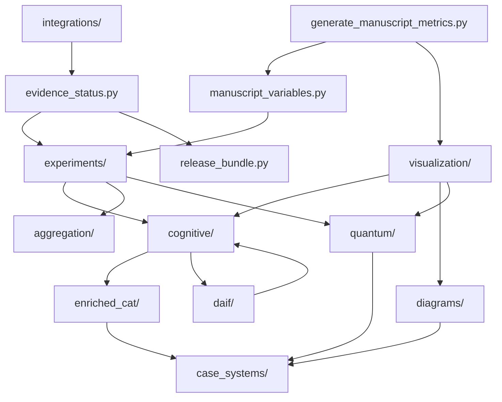

# Cognitive case diagrams

<p align="center">
  <a href="https://github.com/docxology/cognitive_case_diagrams/actions/workflows/ci.yml"></a>
  <a href="https://doi.org/10.5281/zenodo.19695259"></a>
  <a href="LICENSE"></a>
  
</p>

An executable review of case-role graphs, compositional grammar, synthetic uncertainty, and measurement models. Release identity comes from [package configuration](pyproject.toml), [manuscript configuration](docs/manuscript/config.yaml), and generated [citation metadata](CITATION.cff). The code provides explicit examples; it does not implement a complete linguistic parser, general topos bridge, full distributional active-inference learner, EEG model, or operational security system.

Start with the [method contracts](docs/method_contracts.md), [claim ledger](docs/claim_ledger.md), and [manuscript](docs/manuscript/README.md). The [review report](docs/comprehensive_review.md) records changes and verification receipts.

## Run locally

the bound in `pyproject.toml` or newer and `uv` are required. DisCoPy, NumPy, Matplotlib, and the development tools are declared in `pyproject.toml`; `uv.lock` fixes the resolved environment.

```bash
uv sync --frozen
uv run python scripts/quality_gate.py --coverage
uv run python scripts/run_experiments.py
uv run python scripts/generate_diagrams.py
uv run python scripts/inject_variables.py
uv run python scripts/validate_project.py
```

The quality gate runs Ruff, mypy, and the full suite with the configured line-and-branch coverage floor. Its receipt binds test and coverage counts to the tested source tree. Experiments use declared synthetic inputs and independent seeded replicates; their uncertainty does not measure performance on linguistic data. The artifact gate checks hydration, references, image files, registry labels, and checksums. Visual inspection remains a separate requirement.

To render PDF and HTML, run from the sibling **template checkout root** after project injection:

```bash
uv run python scripts/pipeline/stage_03_render.py --project ongoing/ActiveInference/cognitive_case_diagrams --skip-manuscript-hydration
( cd ongoing/ActiveInference/cognitive_case_diagrams && uv run python scripts/correct_web.py )
uv run python scripts/pipeline/stage_04_validate.py --project ongoing/ActiveInference/cognitive_case_diagrams
```

The engine is external to this repository. `scripts/correct_web.py` is project-owned and lives only in the project checkout, so the correction step above runs it from the project root; the template checkout has no such script. Generated artifacts live in `output/`; edit their writers in `src/`, scripts, or numbered manuscript sources. The corrector is the idempotent post-render step that restores the code-block cascade in every rendered HTML page; every re-render removes its marker, so it must be re-run after stage_03 and before stage_04 or any browser check, and a later HTML correction invalidates previously recorded browser acceptance.

The shared template validator has a documented integration limitation with this checkout's category symlink and ignored render outputs; see the [earlier review receipts](docs/comprehensive_review.md#6-verification-receipts). The standalone [release workflow](docs/release_workflow.md) validates the real project root, final artifacts, inspection record, metadata, and reproducibility archive. A local receipt records local evidence; publication requires separately verified remote results.

## Agent access

The optional [MCP integration](docs/agent_integrations.md) exposes bounded numerical operations and read-only project resources through `ccd-mcp`. The [installable skill](skills/cognitive-case-diagrams/SKILL.md) documents evidence boundaries and reproducible workflows. Install the MCP dependency with `uv sync --extra mcp`; downstream wheel users select the `mcp` extra. From a repository checkout, `uv sync` alone suffices because the dev group already includes `mcp` — the [install section](docs/agent_integrations.md#install) documents that path.

## Example

```python
import numpy as np
from src.case_systems import CaseRole
from src.cognitive import CaseDiagramBelief, update_belief
prior = CaseDiagramBelief([CaseRole.NOM, CaseRole.ACC], np.array([0.5, 0.5]))
posterior = update_belief(prior, np.array([0.8, 0.2]))
np.testing.assert_allclose(posterior.probabilities, [0.8, 0.2])
```

The likelihood is supplied synthetic evidence; this example does not parse a sentence.

## Repository map

- [src](src/README.md): numerical and diagram implementations.
- [tests](tests/README.md): real computations, analytic counterexamples, and artifact checks.
- [scripts](scripts/README.md): thin generation and validation entry points.
- [docs](docs/README.md): API, mathematical scope, provenance, and manuscript sources.
- [experiments](src/experiments/README.md): typed synthetic-study configuration, paired controls, uncertainty, and provenance.
- [integrations](src/integrations/README.md): MCP schemas, resources, and stdio entry point.
- `output/`: derived figures, metrics, hydrated chapters, and render products.

This is a self-versioned project. Publish from its own repository, never by force-adding its symlinked contents to the parent workspace or template engine. Software uses [Apache-2.0](LICENSE); the existing Zenodo manuscript series retains its publication license, recorded separately in the deposit metadata.

### Package map

Generated on 2026-11-12 from the `import` statements under `src/`. An arrow from A to B means code in A imports B; arrows already implied by a longer path are left out, so the picture shows layering rather than every edge. It shows 14 of the package's 24 top-level parts: the largest ones that import or are imported by others.


