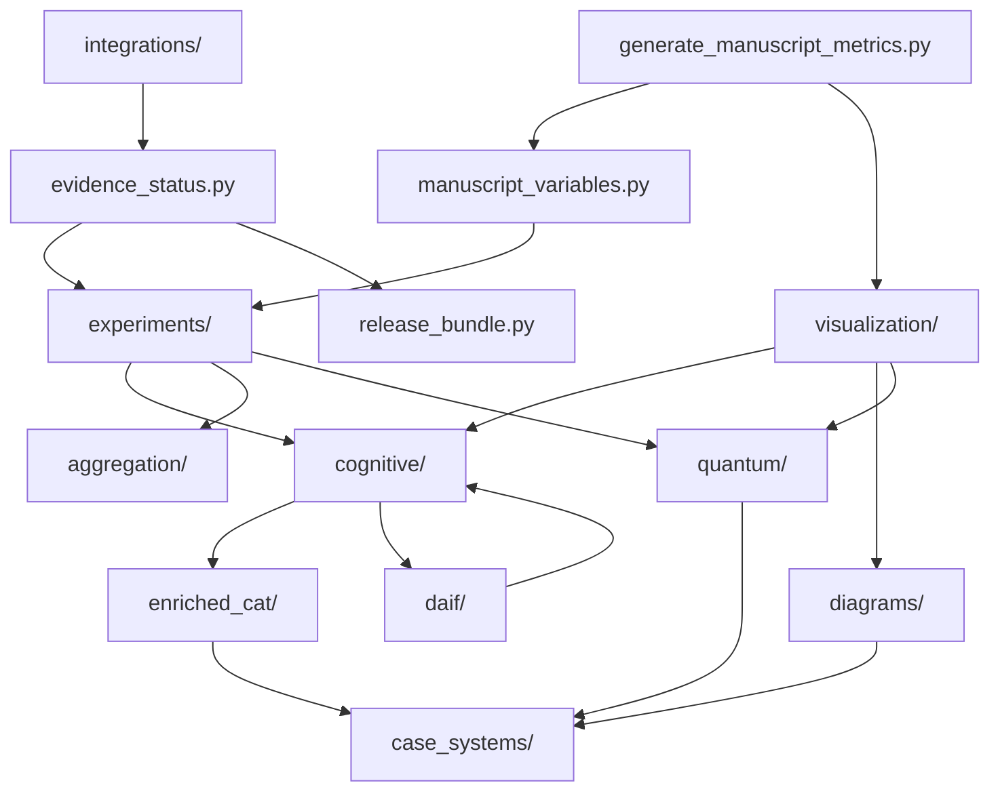

# Architecture and data flow

This is a set of small mathematical examples, not a single trained inference pipeline. `case_systems` provides shared role objects. `diagrams`, `enriched_cat`, `topos_theory`, `cognitive`, `daif`, `quantum`, and `security` implement distinct constructions; `visualization` renders them. The exact import graph is determined by source, including local imports in figure-data helpers. It is not the previously claimed strictly enforced package DAG.

Synthetic fixture writers feed plotting functions. Domain scripts invoke those writers. `generate_diagrams.py` records generated paths, manuscript labels, and SHA-256 hashes. Coverage and source inspection feed `generate_manuscript_metrics.py`. Injection substitutes braced metrics into numbered chapters; artifact validation verifies parity before rendering. The separate template engine consumes `output/manuscript/` and `output/figures/`.

Canonical sources are source code, tests, manuscript chapters, bibliography, and configuration. Outputs are derived and must be regenerated after a relevant source change. A passing structural artifact gate is distinct from a successful renderer and a visual PDF review.

See [API index](api_reference.md), [extension guide](extension_guide.md), and [method contracts](method_contracts.md).

## Package map

Generated on 2026-11-12 from the `import` statements under `src/`. An arrow from A to B means code in A imports B; arrows already implied by a longer path are left out, so the picture shows layering rather than every edge. It shows 14 of the package's 24 top-level parts: the largest ones that import or are imported by others.

